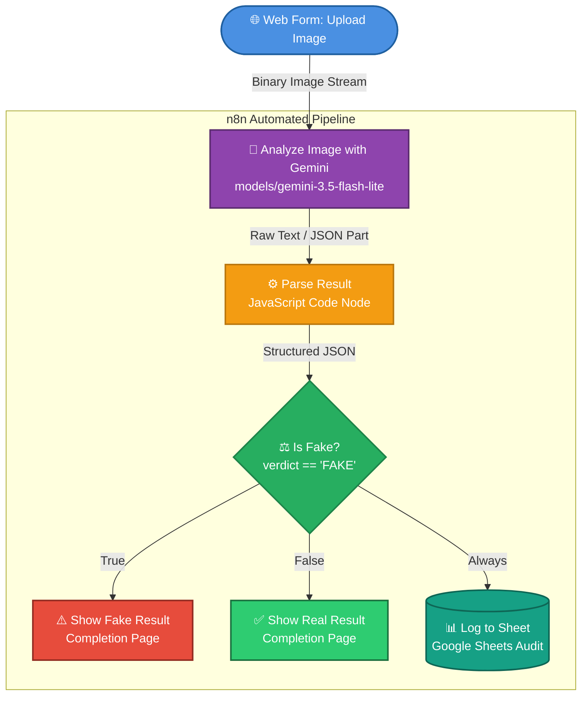
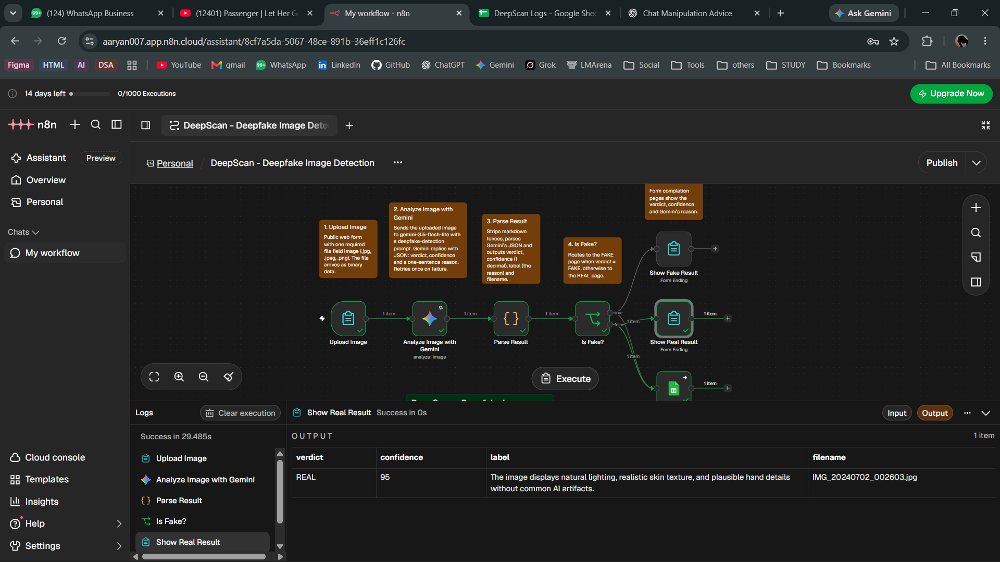
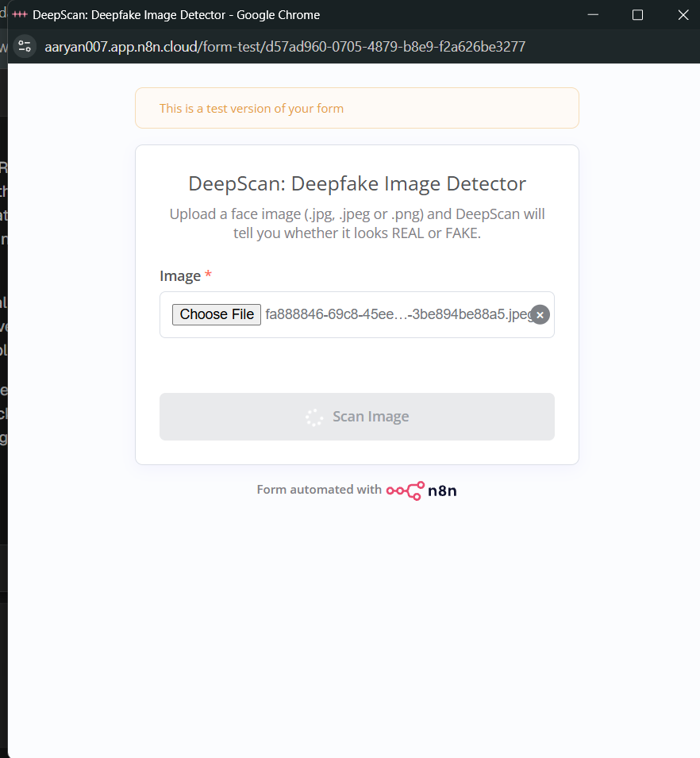
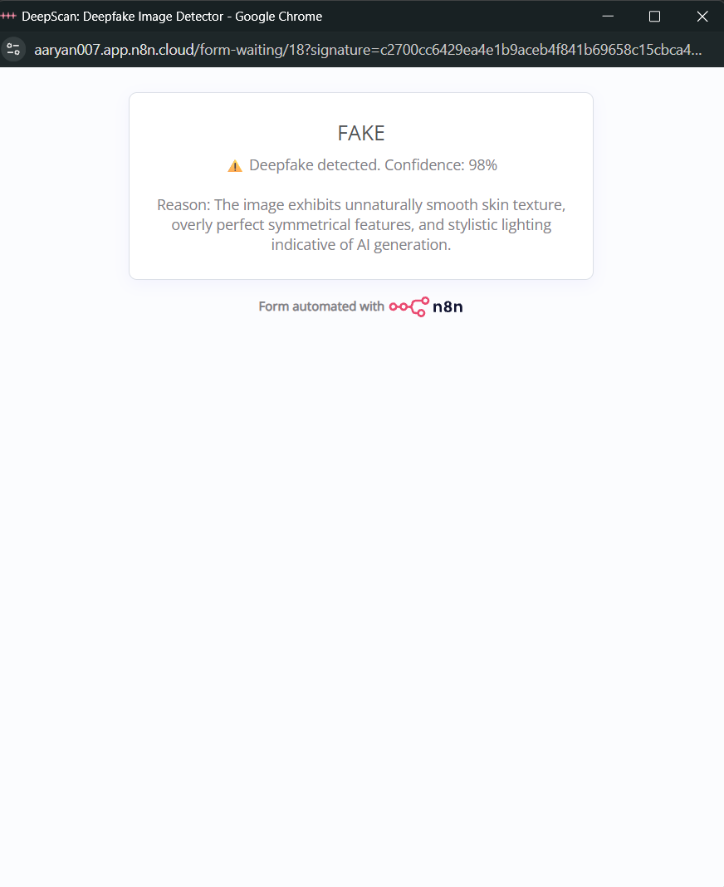
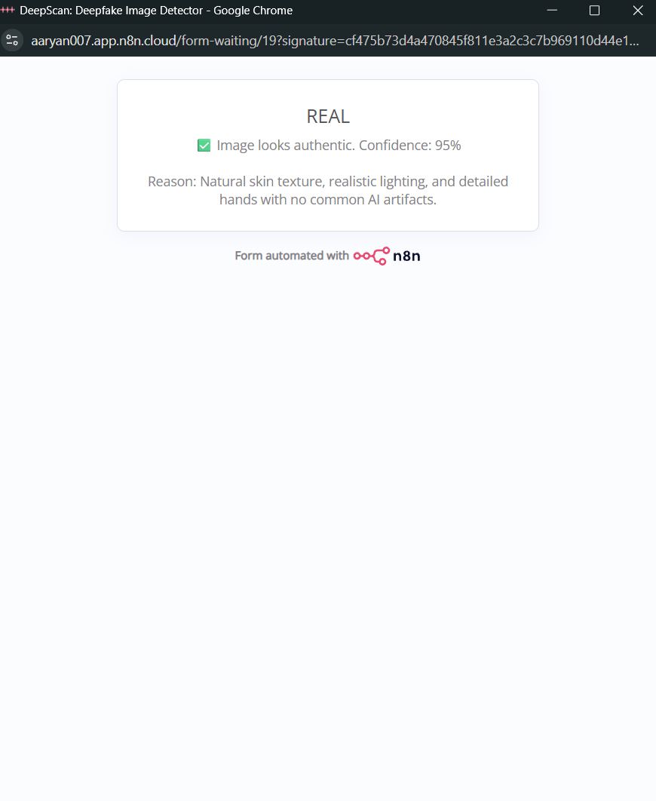
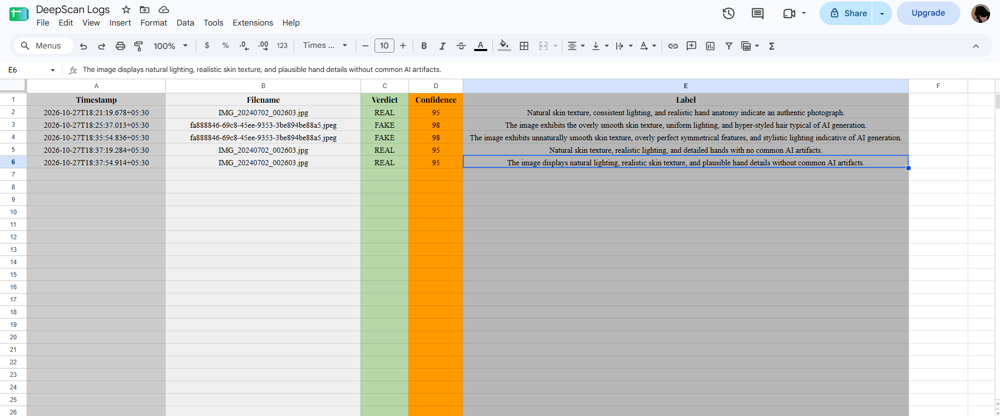
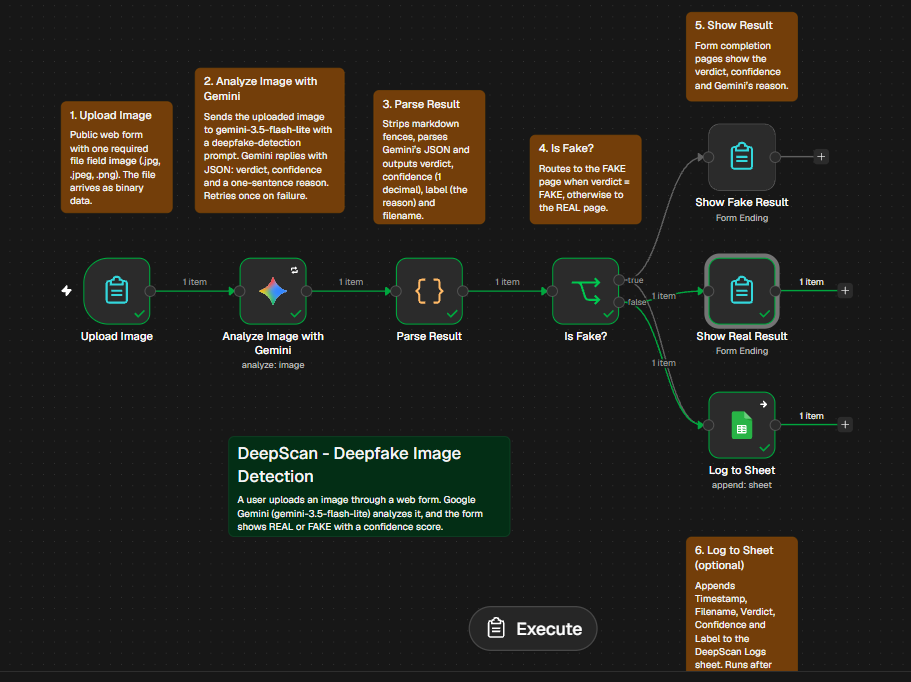

# DeepScan: Automated Deepfake Image Detection Workflow

> **An automated, end-to-end deepfake detection and audit-logging pipeline powered by n8n, Google Gemini Multimodal AI, and Google Sheets.**

[](https://n8n.io/)
[](https://ai.google.dev/)
[](https://sheets.google.com/)
[](LICENSE)

---

## 📌 Overview & Problem Statement

With the rapid proliferation of generative AI tools (such as diffusion models, GANs, and face-swapping algorithms), synthetic and altered facial media—commonly known as **deepfakes**—are becoming indistinguishable from authentic media. The weaponization of deepfakes poses severe threats to digital identity, personal privacy, information integrity, and cybersecurity.

**DeepScan** addresses this challenge by providing a user-friendly, serverless, automated inspection pipeline. Built as an Internal Sessional Exam (ISE) prototype, DeepScan enables users to upload face images through an intuitive web form, leverages Google Gemini's multimodal vision capabilities (`gemini-3.5-flash-lite`) to scrutinize visual forensic artifacts, immediately delivers a verdict (`REAL` or `FAKE`) with confidence score and human-readable explanation, and automatically logs every scan audit trail into Google Sheets.

---

## ✨ Features

- **Intuitive Web Form Interface**: Users can upload `.jpg`, `.jpeg`, or `.png` face images directly from any browser without installing local dependencies.
- **Multimodal AI Analysis**: Powered by Google's `gemini-3.5-flash-lite` vision model to inspect edge blurring, lighting consistency, facial symmetry, skin textures, and synthetic artifacts.
- **Structured JSON Parsing & Sanitization**: Robust JavaScript Code node handles markdown fencing, enforces JSON schema compliance, normalizes verdict values, and scales confidence percentages to a standardized 0–100% range.
- **Dynamic Branch Routing**: Uses an n8n IF node to display dedicated result pages for authentic (`REAL`) versus synthetic (`FAKE`) images.
- **Automated Audit Logging**: Every transaction (ISO timestamp, filename, verdict, confidence %, and reasoning) is automatically appended to a Google Sheet.
- **Fault-Tolerant Execution**: Automatic retry policies on API calls and non-blocking Google Sheets logging ensure uninterrupted end-user response even if logging encounters temporary delays.

---

## 🏗️ Architecture & Workflow



---

## 📸 Screenshots

### 1. Complete n8n Canvas & Execution Pipeline

*Figure 1: Full n8n workflow canvas showing nodes, sticky notes, and execution outputs.*

### 2. DeepScan Web Form

*Figure 2: Web-based upload form for submitting face images.*

### 3. Detection Result: FAKE (Synthetic Media)

*Figure 3: Deepfake detected (98% confidence) citing unnaturally smooth skin texture, overly perfect symmetry, and synthetic lighting.*

### 4. Detection Result: REAL (Authentic Media)

*Figure 4: Authentic image verified (95% confidence) citing natural skin texture, realistic lighting, and plausible anatomy.*

### 5. Google Sheets Audit Logging

*Figure 5: Real-time scan logs recording timestamp, filename, verdict, confidence, and model reasoning.*

### 6. Node Inspection & Execution Details

*Figure 6: Detailed view of the canvas configuration and node connections.*

---

## 🛠️ Tech Stack

| Component | Technology / Service | Description |
| :--- | :--- | :--- |
| **Workflow Engine** | [n8n Cloud](https://n8n.io/) | Low-code event-driven workflow automation platform |
| **Vision AI Model** | [Google Gemini](https://ai.google.dev/) (`models/gemini-3.5-flash-lite`) | Multimodal LLM analyzing facial visual anomalies & synthetic patterns |
| **Transformation** | n8n Code Node (JavaScript / Node.js) | Strips markdown fences, parses JSON, and normalizes output schema |
| **Storage & Logging** | [Google Sheets API](https://developers.google.com/sheets/api) (OAuth2) | Centralized cloud spreadsheet storing historical scan audit logs |
| **Trigger / UI** | n8n Form Trigger & Form Ending Nodes | Responsive web interface for image intake and result rendering |

---

## ⚙️ How It Works (Node Breakdown)

1. **Upload Image (`n8n-nodes-base.formTrigger`)**:
   Serves a public web form accepting single image files (`.jpg`, `.jpeg`, `.png`). It captures the file in binary format under the property name `image` and operates in `lastNode` response mode to return the workflow outcome directly to the user.
2. **Analyze Image with Gemini (`@n8n/n8n-nodes-langchain.googleGemini`)**:
   Transfers binary image data directly to `models/gemini-3.5-flash-lite` with an explicit forensic prompt instructing the model to inspect facial texture, illumination consistency, boundary artifacts, and hand/teeth geometry. The model is constrained to return a strict JSON payload:
   ```json
   {
     "verdict": "FAKE" | "REAL",
     "confidence": 0-100,
     "reason": "one short sentence"
   }
   ```
   Configured with retry-on-fail (2 attempts, 3000ms delay) to handle transient rate limits.
3. **Parse Result (`n8n-nodes-base.code`)**:
   A resilient JavaScript node that:
   - Recursively extracts text across single, candidate, or multipart response formats.
   - Strips backticks and markdown fences (` ```json `).
   - Validates JSON parsing and falls back gracefully.
   - Enforces uppercase `FAKE` or `REAL` verdicts, normalizes confidence (converts 0–1 decimals to 0–100% and rounds to 1 decimal place), and attaches the original file name.
4. **Is Fake? (`n8n-nodes-base.if`)**:
   Evaluates if `verdict == 'FAKE'`. Evaluates strictly and routes flow to the appropriate completion screen while concurrently feeding the Google Sheets logging node.
5. **Show Fake Result / Show Real Result (`n8n-nodes-base.form`)**:
   Presents tailored completion banners displaying the classification verdict icon, confidence percentage, and model rationale to the end-user.
6. **Log to Sheet (`n8n-nodes-base.googleSheets`)**:
   Appends a structured row containing `Timestamp`, `Filename`, `Verdict`, `Confidence`, and `Label` to the target Google Sheet. Set to continue on error (`onError: continueRegularOutput`) to ensure user-facing responses succeed even during cloud storage hiccups.

---

## 🚀 Setup & Installation

### Prerequisites
- An active [n8n](https://n8n.io/) instance (Cloud or self-hosted).
- A Google Cloud / Google AI Studio API Key ([aistudio.google.com/apikey](https://aistudio.google.com/apikey)).
- A Google account with access to Google Drive & Google Sheets.

### Step-by-Step Configuration

1. **Import the Workflow**:
   - In your n8n workspace, navigate to **Workflows** -> **Import from File**.
   - Select [`workflow.json`](workflow.json).

2. **Configure Google Gemini Credential**:
   - Go to **Credentials** -> **New Credential** -> **Google Gemini(PaLM) API**.
   - Paste your Gemini API key generated from [Google AI Studio](https://aistudio.google.com/apikey).
   - In the `Analyze Image with Gemini` node, assign this credential and verify the model is set to `models/gemini-3.5-flash-lite`.

3. **Configure Google Sheets OAuth2**:
   - Go to **Credentials** -> **New Credential** -> **Google Sheets OAuth2 API**.
   - Follow the standard Google OAuth consent flow to connect your Google account.

4. **Prepare the Google Sheet**:
   - Create a new Google Spreadsheet named `DeepScan Logs`.
   - In `Sheet1`, create row 1 headers exactly as follows:
     ```text
     Timestamp | Filename | Verdict | Confidence | Label
     ```
   - In the `Log to Sheet` node, select your spreadsheet and target `Sheet1`.

5. **Activate and Test**:
   - Toggle the workflow switch to **Published / Active**.
   - Open the public form URL provided by the `Upload Image` node.
   - Upload a test image and observe the real-time verdict and Google Sheets entry.

---

## ⚠️ Limitations

- **General-Purpose Multimodal Model**: `gemini-3.5-flash-lite` is a general-purpose vision-language foundation model rather than a purpose-trained deepfake classification architecture (such as specialized MesoNet, EfficientNet-B4, or Xception models).
- **Heuristic Reliance**: Detection relies on visible visual cues and semantic artifacts; it may miss subtle latent-space distortions, high-fidelity diffusion outputs, or heavily compressed media.
- **Accuracy Not Guaranteed**: Confidence metrics reflect model self-estimation and should not be treated as mathematical ground truth.
- **Not for Forensic or Legal Use**: This prototype is strictly an academic demonstration and should not be used in legal, law enforcement, or security-critical verification workflows.

---

## 🔮 Future Work

- **Dedicated Deepfake Neural Network Integration**: Expose a custom Vision Transformer (ViT) or fine-tuned CNN model via a REST API endpoint to replace or ensemble with the LLM. *(Currently being trained on the official benchmark dataset for the upcoming **IIIT Bangalore Deepfake ML Hackathon**).*
- **Temporal Video Deepfake Analysis**: Frame-by-frame extraction via FFmpeg nodes to inspect facial temporal coherence and audio-visual lip synchronization.
- **Automated Alerts**: Real-time notifications via Telegram bot, Slack, or email webhook whenever high-confidence deepfakes are intercepted.
- **EXIF & Metadata Forensics**: Integration of metadata parsers to cross-reference camera metadata, software tags, and compression signatures.

---

## 👨‍💻 Author

- **Name**: Aaryan Gajgeshwar
- **Roll No**: 133
- **Institution**: D. Y. Patil College of Engineering and Technology (DYPCET)
- **Project Context**: Academic Internal Sessional Examination (ISE) prototype.

> *Note: This n8n prototype is an independent academic exploration and is distinct from the author's submission for the IIIT Bangalore Deepfake ML Hackathon (deadline: 13 Nov 2026), where a custom ML model is being trained on the official dataset.*

---

## 📄 License

This project is licensed under the [MIT License](LICENSE) - see the LICENSE file for details.
